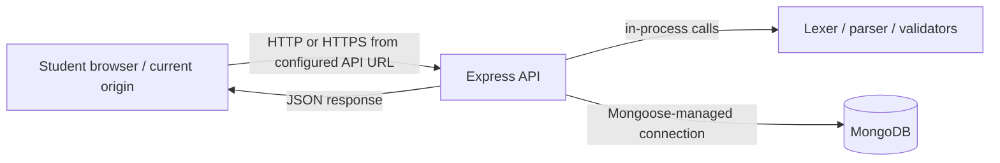

# Computer Networks Topology

The UI uses the current browser origin and configured API URL to label the application request path. `/api/network/status` reports Express service identity, process uptime, configured listening port, and Mongoose connection health. Parser services run inside the backend process. The database is MongoDB through Mongoose.

This is an application-level request flow, not packet capture. CDN/reverse-proxy topology, DNS answers, public/private IPs, gateway, client ephemeral port, database host/port, and proxy-to-backend TLS are not exposed by this app and are shown as unavailable. HTTPS labeling is based on the configured API URL scheme only.
