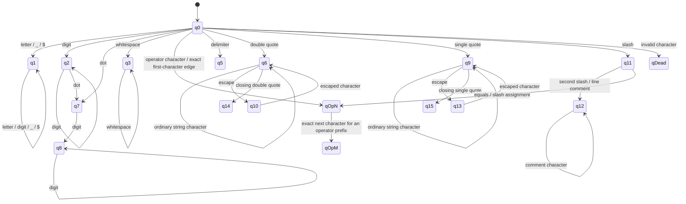

# DFA Lexical Recognizer

The UI loads states and transition rows from `backend/src/analyzers/dfa.js`. That definition is the source for the diagram, the `/api/lexer/dfa` table, the simulator, and the lexer. The recognizer tokenizes a documented JavaScript-like teaching subset; the parser remains responsible for grammar.

`q1`, `q2`, `q3`, `q5`, `q8`, `q11`, `q12`, `q14`, `q15`, and any `qOpN` whose prefix is a complete operator are accepting states (keywords are classified after identifier recognition). Each generated `qOpN` encodes one exact operator prefix, so no hidden input buffer is needed to determine transitions. `q0` is the start state. `qDead` marks a rejected character; the lexer reports its 1-based position and restarts at `q0` to continue collecting diagnostics. Accepting token boundaries return control to the scanner at `q0`; that reset is scanner control, not a consumed character transition. The simulator caps returned trace output at 2,000 transitions.

The browser highlights current/traversed transitions for the submitted simulation. The diagram is a visual state view; the scanner API is the executable source of truth.
