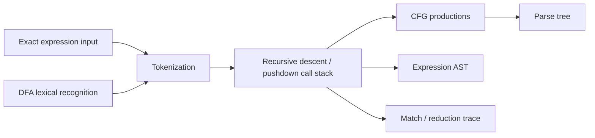

# FLAT Parsing Views

The `/parser` page is the separate educational lab; it does not replace Code Editor results. Arithmetic expressions use `E → T E′`, `T → F T′`, `F → ( E ) | id | number` with additive and multiplicative tails. The existing expression endpoint returns reductions and an arithmetic AST. The current view does not yet render a separate fully expanded grammar CST, full LL(1) table for that expression grammar, or PDA push/pop table; these are partial/unavailable and are not represented by a fake diagram. MiniC Core has its own real parse tree and AST generated by its assessment parser. See `CFG.md` for its correctly derived FIRST/FOLLOW/table.

Beginner summary: a DFA recognizes regular token shapes; a CFG describes nested syntax; recursive descent checks grammar rules; a parse tree preserves rule structure; an AST keeps the essential meaning; an arithmetic AST encodes operator order.
