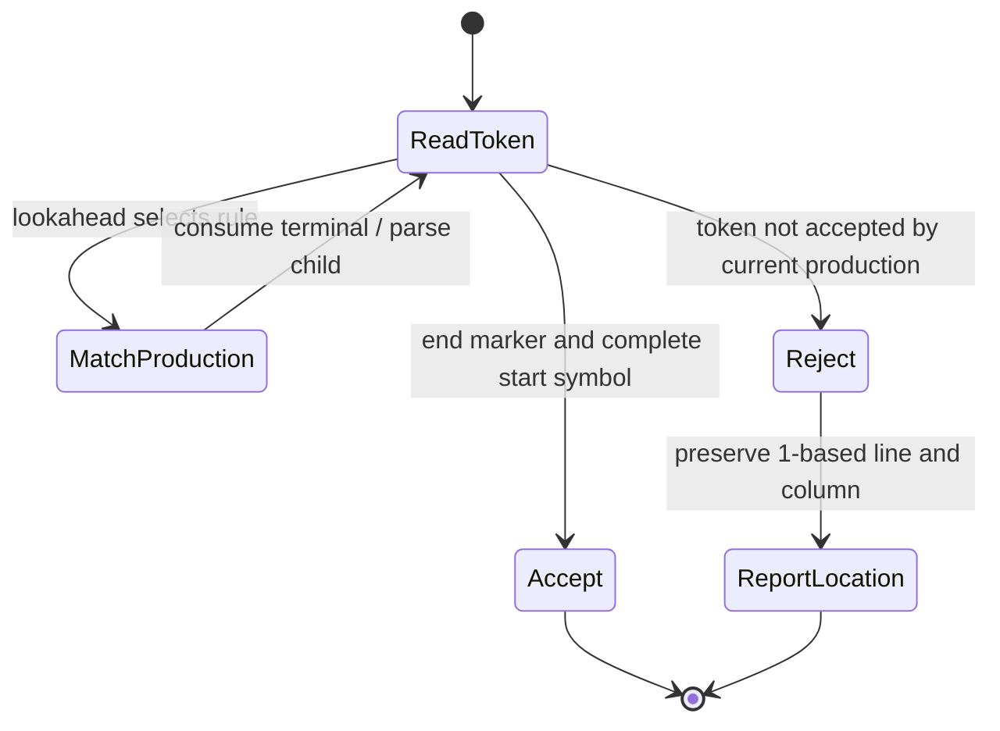

# Parser State Transition Diagram

For the arithmetic grammar, `E` calls `T`, `T` calls `F`, and the loops in `E′` and `T′` encode left-associative operators. MiniC profiles use the same recursive-descent approach but separate production sets.
